# Architecture

## Scope and design goals

System Design Studio produces architecture proposals grounded in a curated technical knowledge base and a structured component catalog. The system is designed to keep probabilistic generation behind explicit boundaries: provider interfaces make models replaceable, Pydantic schemas constrain planner output, and a deterministic validator checks proposals before they are presented.

The current deployment is a single FastAPI service, PostgreSQL, Qdrant, and a React frontend. The repository has production-oriented pieces, including containerized services, Alembic migrations, provider abstractions, and tests, but operational readiness still depends on deployment-specific security, observability, capacity, backup, and evaluation work.

## Request and data flow

```mermaid
flowchart TD
    subgraph Ingestion
      Files["Curated PDFs / Markdown"] --> Parser["Format parser"]
      Parser --> Metadata["Source and section metadata"]
      Metadata --> Chunker["Chunking"]
      Chunker --> Embedder["Dense + sparse embeddings"]
      Embedder --> Index[("Qdrant")]
      Metadata --> Relational[("PostgreSQL source records")]
    end
    subgraph Online planning
      Client["React canvas"] --> API["FastAPI routers"]
      API --> Search["Knowledge service"]
      Search --> Index
      Search --> Reranker["Cross-encoder reranker"]
      Search --> Planner["LangGraph planner / LLM adapter"]
      Relational --> Planner
      Planner --> Schema["Pydantic response validation"]
      Schema --> Validator["Deterministic design rules"]
      Validator --> API
      API --> Client
    end
```



### Ingestion path

The authoritative local corpus is `rag_knowledge_base/`; each top-level collection directory becomes a collection identifier. The ingestion CLI detects new or changed files, invokes supported parsers, attaches source/section/licence/date/tag metadata, chunks text, computes vectors, and writes searchable points to Qdrant. PostgreSQL stores source and evaluation records. A full rebuild can be requested with `--recreate`; ordinary ingestion is incremental.

Every ingested source must have a recorded licence or permission basis. Retain origin, licence, publication date, version/refresh metadata, and stable source identifiers so retrieval results remain auditable.

### Online query path

The API receives a knowledge query or a project planning request. The knowledge service retrieves candidate chunks with hybrid dense/sparse search, optionally applies score filtering and reranking, and returns chunk text with citation metadata. The planner combines requirements, retrieved evidence, and catalog facts. Its output is parsed into the declared Pydantic schema; invalid model output must not bypass validation. A deterministic validator checks architecture constraints, and the API returns the proposal, issues, and evidence references to the frontend.

## Repository layout

The current repository is organized by runtime boundary and responsibility. Use the following scalable naming rules for new code; the suggested tree is a convention, not a request to move existing modules:

```text
system-design-studio/
|-- README.md
|-- ARCHITECTURE.md
|-- CONTRIBUTING.md
|-- docker-compose.yml
|-- .github/                       # CI workflows and repository templates
|-- backend/
|   |-- app/
|   |   |-- api/v1/                # HTTP routing and transport concerns
|   |   |-- cli/                   # Ingestion and maintenance commands
|   |   |-- core/                  # Settings, logging, database wiring
|   |   |-- models/                # ORM entities
|   |   |-- repositories/          # Persistence access
|   |   |-- schemas/               # API and planner data contracts
|   |   |-- services/
|   |   |   |-- knowledge/
|   |   |   |   |-- ingestion/     # Parsers and chunking
|   |   |   |   |-- providers/     # Embedding, index, reranker adapters
|   |   |   |-- planner/
|   |   |   |-- validator/
|   |-- alembic/                   # Database migrations
|   |-- tests/                     # Unit and API integration tests
|   |-- pyproject.toml
|-- frontend/
|-- docs/
|-- infrastructure/               # Optional deployment definitions; kebab-case
|-- rag_knowledge_base/            # Licensed source corpus and manifest
|-- scripts/                       # Local maintenance and document generators
```

### Naming rulebook

| Item | Convention | Example |
|---|---|---|
| Repository | kebab-case, concise domain + purpose | `evidence-rag-architecture-studio` |
| Python modules/packages | `snake_case`; package directories use `snake_case` | `notion_loader.py`, `hybrid_retriever.py` |
| Root documentation | `UPPER_SNAKE_CASE.md`; retain conventional `README.md` | `ARCHITECTURE.md`, `CONTRIBUTING.md` |
| Configuration/infrastructure directories | kebab-case | `deployment/`, `model-serving/` |
| Classes | CapWords and role suffix | `NotionLoader`, `HybridRetriever` |
| Interfaces | Role names, avoid implementation in interface | `DocumentLoader`, `VectorStore` |
| Tests | `test_<module>.py`; descriptive `test_<behavior>` functions | `test_hybrid_retriever.py` |
| Connectors/loaders | `<source>_loader.py`; one source adapter per module | `sharepoint_loader.py` |
| Chunkers | `<strategy>_chunker.py` | `heading_aware_chunker.py` |
| Retrievers | `<strategy>_retriever.py` | `hybrid_retriever.py` |

Keep provider-specific code under `providers/`, format-specific parsing under `ingestion/`, and transport code in API routers. Tests mirror the public behavior and use fixtures rather than live provider credentials.

## Chunking strategy

The configured defaults are 512 tokens per chunk and 64 tokens of overlap. Chunking should preserve heading boundaries and section paths where possible, because citations and document structure matter to architecture research. A chunk should be large enough to retain a complete concept, but small enough to avoid retrieving unrelated neighboring material.

Treat chunk size and overlap as evaluation parameters, not universal constants. Compare candidate settings against the curated evaluation questions for recall, reciprocal rank, citation usefulness, and downstream answer quality. Preserve stable source IDs, chunk IDs, collection, title, section path, page (when available), licence, date, and tags in the index payload. Avoid splitting tables or code examples in ways that destroy their meaning.

## Embeddings, indexing, and retrieval

The default embedding provider is `bge-m3`, producing dense and sparse representations. Qdrant stores both representations and performs hybrid retrieval with reciprocal-rank fusion. The collection name is configurable. `hash` embeddings are useful for deterministic/offline tests but are not semantically meaningful and must not be used to judge production retrieval quality.

The default reranker is the `bge-reranker-v2-m3` cross-encoder. It improves ordering by scoring query-candidate pairs, at the cost of model load and per-query latency. The lightweight lexical reranker is a development fallback, not an accuracy-equivalent replacement. Keep candidate retrieval broad enough to preserve recall, then rerank a bounded candidate set. Tune candidate count and final result count using measured evaluation results and latency budgets.

Use explicit collection/schema versioning when embedding model or vector dimensions change. Rebuild or migrate indexes deliberately; do not silently mix incompatible vectors. Keep the provider interface stable so Qdrant, embedding, and reranker implementations can be replaced without changing API schemas or planning logic.

## Planner, grounding, and validation

The planner receives user requirements, retrieved evidence, and catalog facts. The catalog and deterministic rules are authoritative for component compatibility and limits; the LLM is a proposal generator, not the source of truth. Validate every generated response against Pydantic schemas, bound retries for malformed output, retain evidence IDs and assumptions, and run validator rules before returning a design.

Validator functions should be deterministic and independently unit-tested. A rule change should include a passing case and a failing case. Preserve the retrieval trace, selected chunk identifiers, model/provider identifiers, validator findings, and evaluation outcome with appropriate privacy controls.

## Latency and accuracy trade-offs

| Choice | Accuracy/quality effect | Latency/cost effect |
|---|---|---|
| Larger chunk size | More surrounding context; may mix topics | Fewer index points and less retrieval overhead |
| More overlap | Reduces boundary misses | More storage and near-duplicate candidates |
| Dense + sparse hybrid | Balances semantic and exact-term matches | More indexing and query work than one representation |
| Larger candidate set | Improves chance of retrieving evidence | More vector-store transfer and reranker work |
| Cross-encoder reranking | Usually improves top-result precision | Adds model inference latency and compute |
| Larger local LLM | Can improve reasoning on complex proposals | Higher memory, runtime, and throughput cost |
| Lower result count | Tighter prompt and less noise | Risks omitting useful evidence |

Set service-level budgets per stage: API/database, retrieval, reranking, generation, and validation. Measure p50/p95 latency, retrieval recall/MRR, citation correctness, schema validity, validator pass rate, and human ratings. Use caching only with clear invalidation keys that include corpus/index and model versions.

## Persistence and deployment

PostgreSQL stores transactional project/catalog/source/evaluation data and is migrated with Alembic. Qdrant stores dense/sparse knowledge vectors. Docker Compose provides the local development topology. Production deployment should additionally define managed secrets, restricted network paths, authentication/authorization, TLS, backups and restore tests, resource limits, health/readiness probes, structured metrics/traces, retention policies, and a documented index rebuild procedure.

Use environment configuration rather than committing credentials. The example environment file contains development defaults; replace weak local credentials before exposing any service outside the development machine.

## Evaluation and change control

The evaluation set lives in `data/eval_questions.json` and is also supported through the knowledge evaluation API/CLI. Run retrieval evaluations after changing parsers, chunking, metadata, embeddings, filters, rerankers, prompts, or LLMs. Review regressions in recall@k and MRR alongside answer grounding and citation correctness; aggregate scores alone can hide a failure on a critical collection.