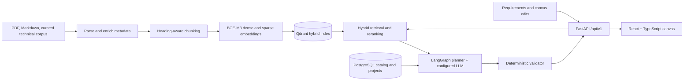

# System Design Studio

System Design Studio is an evidence-backed AI assistant for turning application requirements into structured system architectures. It retrieves technical knowledge and catalog facts, generates a schema-validated proposal, runs deterministic architecture checks, and presents the result on an interactive React Flow canvas.

## Repository names

Suitable kebab-case names for this project are:

- `system-design-studio` (current repository name)
- `evidence-rag-architecture-studio`
- `architecture-design-copilot`

## Architecture at a glance



The relational database stores projects, designs, catalog data, and evaluation records. Qdrant stores the searchable knowledge chunks. Model, embedder, reranker, and vector-store choices are configured behind provider interfaces.

## Technology

- Backend: Python 3.11+, FastAPI, Pydantic v2, async SQLAlchemy, Alembic
- RAG: LlamaIndex ingestion, BAAI/bge-m3 dense and sparse embeddings, Qdrant hybrid retrieval, BAAI/bge-reranker-v2-m3 reranking
- Planning: LangGraph with a configurable Ollama/vLLM/mock LLM provider
- Frontend: React, TypeScript, Vite, React Flow
- Local services: Docker Compose, PostgreSQL 16, Qdrant

## Quickstart

Prerequisites: Docker Compose, Python 3.11+, and Node.js/npm. The compose stack starts PostgreSQL, Qdrant, the API, and the web UI.

1. Copy `.env.example` to `.env` at the repository root for Docker Compose interpolation. Change the development database password if the ports or credentials conflict with your machine.
2. Start the services:

```bash
docker compose up -d --build
docker compose exec backend alembic upgrade head
```

3. Open the frontend at <http://localhost:3000>, API docs at <http://localhost:8000/docs>, and Qdrant dashboard at <http://localhost:6333/dashboard>.

The API reads settings from process environment variables and `.env` in its working directory. For local backend development, copy the root `.env.example` to `backend/.env`. The Compose file passes selected settings into the API; root `.env` values are not automatically passed through unless referenced in `docker-compose.yml`. To override a provider in Compose, add an explicit `backend.environment` mapping (for example `EMBEDDING_PROVIDER: ${EMBEDDING_PROVIDER:-hash}`). Its application defaults include PostgreSQL, Qdrant, Ollama at `http://localhost:11434`, and BGE-M3 embedding/reranking providers. To use a host-installed Ollama from Docker, explicitly pass `LLM_BASE_URL` with a reachable address such as `http://host.docker.internal:11434`; container `localhost` is not the host. GPU acceleration is recommended for full-corpus embedding and cross-encoder reranking. For lightweight offline development, set `EMBEDDING_PROVIDER=hash`, `RERANKER_PROVIDER=lexical`, and `LLM_PROVIDER=mock` in `backend/.env` or pass them explicitly to Compose.

### Run the frontend separately

When running the API in Docker, the Vite dev server is optional:

```bash
npm --prefix frontend install
npm --prefix frontend run dev -- --host 0.0.0.0
```

Vite listens on port 3000 and proxies `/api` requests to `http://localhost:8000`.

### Run the backend locally

Start PostgreSQL and Qdrant first (for example with `docker compose up -d postgres qdrant`), copy `.env.example` to `backend/.env`, then:

```bash
cd backend
# PowerShell; on macOS/Linux use: cp ../.env.example .env
Copy-Item ..\.env.example .env
python -m venv .venv
# Windows PowerShell
.venv\Scripts\Activate.ps1
# macOS/Linux: source .venv/bin/activate
python -m pip install -r requirements.txt
uvicorn app.main:app --reload --host 0.0.0.0 --port 8000
```

The API's startup lifecycle does not automatically apply migrations. Apply Alembic migrations after starting the Compose services, as shown above, or from the local backend environment:

```bash
cd backend
alembic upgrade head
```

## API examples

Search the knowledge base (all routes are prefixed with `/api/v1`):

```bash
curl -X POST http://localhost:8000/api/v1/knowledge/search \
	-H "Content-Type: application/json" \
	-d '{"query":"How should a highly available service handle database failover?","limit":5,"use_reranker":true}'
```

Ingest a permitted text document with provenance metadata:

```bash
curl -X POST http://localhost:8000/api/v1/knowledge/ingest \
	-H "Content-Type: application/json" \
	-d '{"title":"Service reliability notes","collection":"01_fundamentals","content":"Document text goes here.","licence":"CC-BY-4.0","tags":["reliability"]}'
```

Check service health:

```bash
curl http://localhost:8000/health
```

Interactive endpoint schemas are available in Swagger at `/docs` when `DEBUG=true`.

## Ingest the curated RAG corpus

`rag_knowledge_base/` is the authoritative corpus. The ingestion CLI parses supported Markdown/PDF material, creates chunks with source metadata, generates dense and sparse vectors, and indexes them in Qdrant. Hybrid retrieval uses Qdrant fusion and the configured reranker.

```bash
cd backend
python -m app.cli.ingest_corpus --recreate --eval
python -m app.cli.ingest_corpus
python -m app.cli.ingest_corpus --collections 03_component_decision_guides
```

Use `--recreate` for a fresh index or after changing embedding dimensions/model. The incremental command processes changed files. For CPU-only development, use the lightweight providers above; a full BGE-M3 corpus ingest may take substantial time on CPU.

## Tests and checks

```bash
cd backend
pytest
ruff check .
black --check .
mypy app
```

Frontend production build/type check:

```bash
npm --prefix frontend run build
```

See [ARCHITECTURE.md](ARCHITECTURE.md), [CONTRIBUTING.md](CONTRIBUTING.md), and [docs/ARCHITECTURE.md](docs/ARCHITECTURE.md) for design and project workflow details. To generate the onboarding Word document, install `python-docx` and run `python scripts/generate_guideme.py`.
