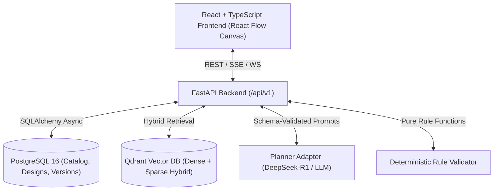

# System Architecture Documentation

## Overview
System Design Studio is an evidence-backed AI architecture assistant that turns natural language application ideas (such as a Tinder-like dating app) into structured, validated, and interactive system designs on an infinite canvas.

## System Topology

## Key Layers
1. **Frontend**: Vite + React + TypeScript + React Flow infinite canvas.
2. **Backend**: FastAPI with async SQLAlchemy, Pydantic v2 schemas, and modular routing.
3. **Database**: PostgreSQL 16 managed via Alembic migrations.
4. **Vector Store**: Qdrant with dense and sparse vectors for evidence grounding.
5. **Deterministic Validator**: Standalone pure rule checks ensuring architectural validity, connection compatibility, and reliability bounds.
6. **Simulation Engine**: Load testing simulation for capacity scaling (1, 100, 1k, 100k users) and tier cost estimation.
